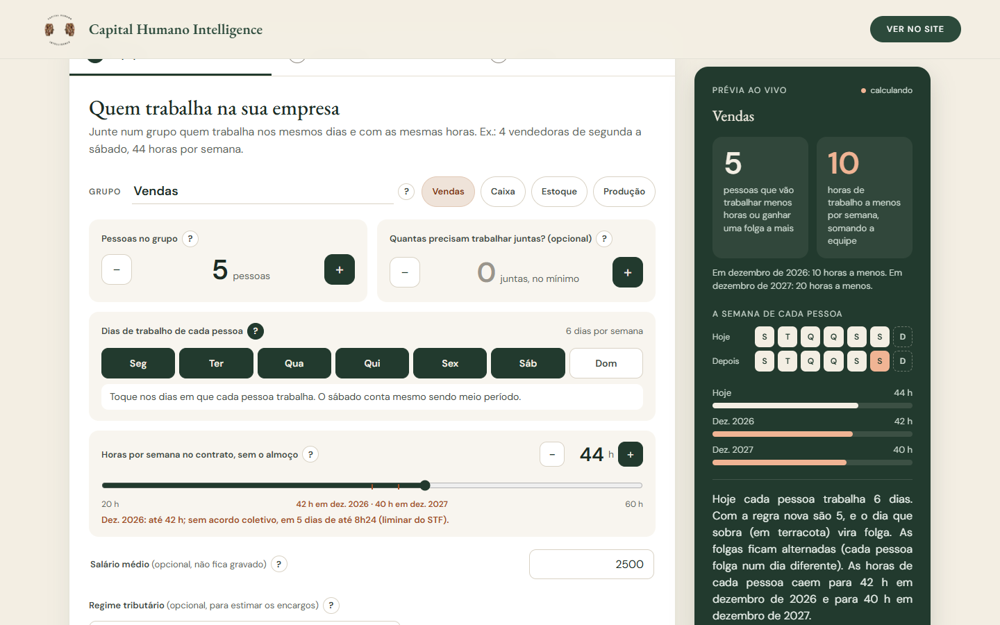
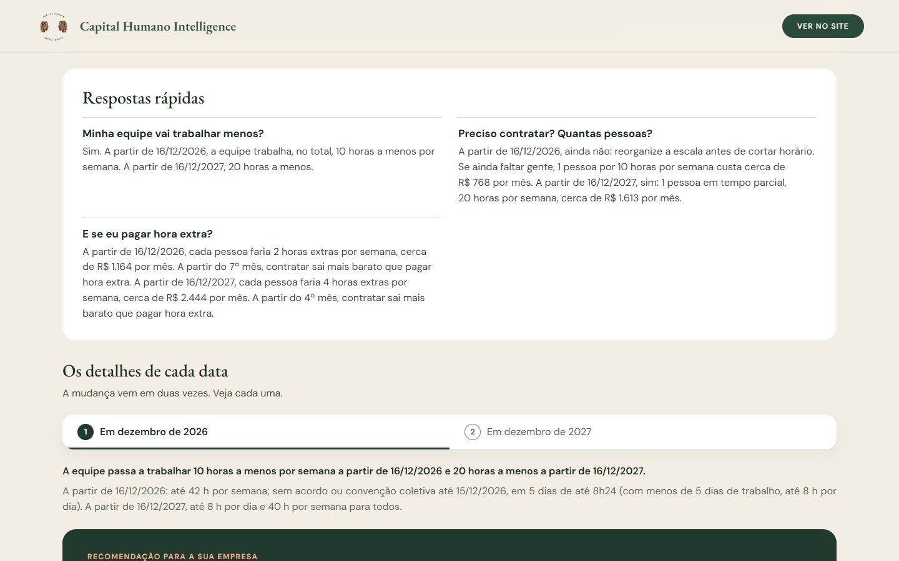
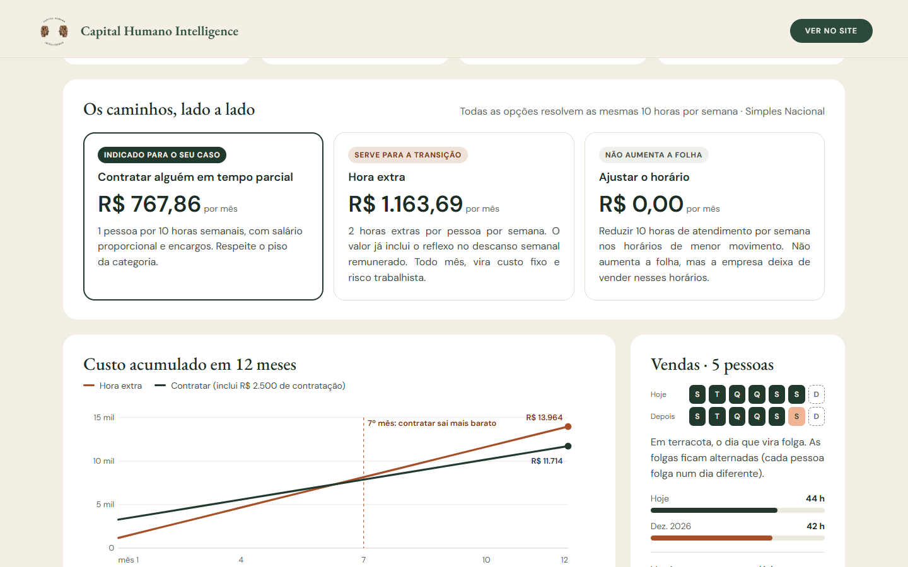

# Calculadora da escala 6x1

**Sua escala cabe na regra nova?** Uma calculadora para pequenas e médias empresas descobrirem o que muda com o fim da escala 6x1: quem é afetado, quantas horas de trabalho deixam de existir e quanto custa cada caminho para se adaptar.

**Versão no ar:** [capitalhumanointelligence.com/escala-6x1](https://capitalhumanointelligence.com/escala-6x1)

Criei esta calculadora para a Capital Humano Intelligence, a minha consultoria de gestão de pessoas. Sou Daniela Matos e você me encontra no [LinkedIn](https://www.linkedin.com/in/danielamatosfreitas).

[English version below](#english)

| Computador | Celular |
|---|---|
|  |  |
|  |  |
|  |  |

## O problema

A emenda constitucional que acaba com a escala 6x1 foi publicada em 16/10/2026. A jornada máxima cai em duas etapas e cada pessoa passa a ter dois dias de descanso por semana. Para quem tem uma loja, um mercado ou uma clínica, as perguntas são práticas: minha equipe vai trabalhar menos? Vou ter gente para atender nos dias de folga? Preciso contratar? Sai mais barato contratar ou pagar hora extra?

Essas respostas dependem de contas que pouca gente faz sozinha. Por isso fiz uma ferramenta que faz essas contas com os números da própria empresa.

## A solução

Uma página em 3 passos, em linguagem simples:

1. **Equipe:** grupos de pessoas que trabalham nos mesmos dias e com as mesmas horas (quantas pessoas, dias, horas por semana, salário médio opcional e regime tributário opcional).
2. **Atendimento:** horário em que a empresa abre e fecha.
3. **Resultado:** respostas rápidas, os números de cada etapa (a partir de 16/12/2026 e a partir de 16/12/2027), uma recomendação, três caminhos lado a lado (contratar, pagar hora extra ou ajustar o horário), o mês em que contratar passa a sair mais barato e um PDF gerado pelo próprio navegador, com o que fazer primeiro.

Uma prévia ao vivo mostra o efeito enquanto a pessoa preenche.

## A regra usada

Regras conferidas em 24/11/2026, iguais às da versão no ar.

* **Hoje:** até 44 horas por semana, com 1 folga.
* **A partir de 16/12/2026:** escala 5x2, com dois dias de descanso por semana e até 42 horas semanais. Sem acordo ou convenção coletiva até 15/12/2026, as 42 horas podem ser feitas em 5 dias de até 8h24, por decisão liminar do STF de 12/11/2026, ainda sujeita a referendo do plenário. Até 15/12/2027, os 24 minutos acima da oitava hora não geram hora extra. Com menos de 5 dias de trabalho, o limite continua 8 horas por dia.
* **A partir de 16/12/2027:** até 8 horas por dia e 40 horas por semana.
* Salário e piso não podem ser reduzidos, e intervalos e descansos continuam valendo.
* Com convenção ou acordo coletivo, as folgas podem ser compensadas em prazo maior que a semana ou o mês, desde que se preservem dois descansos por semana no total, um deles de preferência no domingo.

A calculadora não pergunta sobre acordo ou convenção: usa para todos a regra das 42 horas em 5 dias de até 8h24 na primeira etapa.

### Fontes legais

Conferidas em 24/11/2026.

* Emenda Constitucional 141/2026, publicada no Diário Oficial da União em 16/10/2026: art. 6º, I e II, e art. 10, I (datas das duas etapas).
* Decisão liminar do STF de 12/11/2026 nas ADIs 8041 e 8042, ainda sujeita a referendo do plenário (42 horas em 5 dias de até 8h24 sem acordo ou convenção coletiva até 15/12/2026, e compensação das folgas por acordo ou convenção).
* CLT, art. 58-A e § 1º (trabalho em tempo parcial, até 30 horas por semana, com salário proporcional).

### Como o cálculo funciona

* Dias novos = mínimo(dias de hoje, 5).
* Horas novas a partir de 16/12/2026 = mínimo(horas, 42, dias novos × 8,4) com 5 dias de trabalho; mínimo(horas, 42, dias novos × 8) com menos de 5 dias.
* Horas novas a partir de 16/12/2027 = mínimo(horas, 40, dias novos × 8).
* Horas a menos = (horas de hoje menos horas novas) × pessoas do grupo.
* Cobertura (opcional): quando a pessoa informa quantas precisam trabalhar juntas, a conta compara as horas e os dias de presença necessários com o que a equipe consegue fazer depois da mudança. Se faltam dias de trabalho, hora extra não resolve.
* Tempo parcial: até 30 horas por semana a cobrir, a conta indica 1 pessoa em tempo parcial (CLT, art. 58-A), com salário proporcional às horas contratadas sobre as horas semanais novas do grupo, a mesma base do valor da hora extra (art. 58-A, § 1º). Acima de 30 horas, pessoas em tempo integral pela jornada da etapa (42 ou 40 horas); a sobra de 12 a 30 horas vira 1 pessoa em tempo parcial, acima de 30 vira mais 1 em tempo integral, e abaixo de 12 fica com ajuste de horário ou hora extra.
* Custo de contratar: 1 salário inteiro por pessoa no primeiro mês (seleção, admissão e treinamento), também no tempo parcial. Só o salário de cada mês é proporcional às horas.
* Poucas horas a cobrir (de 1 a 11 por semana): a recomendação é reorganizar a escala antes de cortar horário, e a página mostra o custo por hora coberta de contratar e da hora extra.
* Encargos: fator 1,29 no Simples Nacional (13º, férias com o terço e FGTS) e 1,62 fora dele; "Não sei" mostra a faixa.
* Hora extra: horas × 4,33 × valor da hora × 1,5 × 7/6 (descanso semanal remunerado) × fator de encargos.

## Tecnologias

* HTML, CSS e JavaScript puro, sem framework e sem etapa de build.
* O cálculo é uma função pura (`calcular`, `etapa` e `custos` em `js/escala-6x1.js`), separada da tela e usada também pela prévia ao vivo.
* Testes com o executor de testes nativo do Node.js (`node --test`), sem dependências.
* Acessibilidade: contraste WCAG AA, rótulos em todos os campos, navegação por teclado nas abas, respeito a "reduzir movimento".
* Layout responsivo do celular (360 px) a telas grandes, e PDF pela impressão do navegador.
* Fontes EB Garamond e DM Sans servidas pelo próprio projeto.

## Como rodar

Abra o `index.html` no navegador. Para servir por HTTP (recomendado, por causa das fontes):

```bash
npx serve .
```

## Testes

Precisa do Node.js 18 ou mais novo.

```bash
npm test
```

São 35 testes, em `tests/calculadora.test.js` (cálculo) e `tests/recomendacao.test.js` (recomendação e caminhos).

### A loja de exemplo

Uma loja com 5 pessoas que trabalham 6 dias e 44 horas por semana, salário médio de R$ 2.500, no Simples Nacional. Os números abaixo são os que a calculadora no ar mostra e os que os testes conferem:

| | Dezembro de 2026 | Dezembro de 2027 |
|---|---|---|
| Horas a menos por semana, somando a equipe | 10 | 20 |
| Contratar (1 pessoa em tempo parcial) | R$ 767,86 por mês | R$ 1.612,50 por mês |
| Hora extra | R$ 1.163,69 por mês | R$ 2.443,74 por mês |
| Contratar passa a sair mais barato | no 7º mês | no 4º mês |
| Recomendação | reorganizar a escala antes de cortar horário | contratar 1 pessoa por 20 horas semanais |

Em dezembro de 2026, com só 10 horas a cobrir, a página também mostra o custo por hora coberta: cerca de R$ 17,73 para contratar e R$ 26,88 na hora extra.

Os testes cobrem ainda: regime tributário, equipe que não muda, mudança só pela folga, cobertura do horário, falta de dias (hora extra não resolve), dados impossíveis, contratação em pessoas inteiras e os textos da recomendação para poucas horas.

## Aviso

O resultado é uma **estimativa**. Não substitui a orientação do contador nem a convenção coletiva da categoria. A decisão liminar do STF ainda pode mudar no referendo do plenário, as regras de transição ainda podem ser detalhadas, e escalas de revezamento, como a 12x36, seguem regras próprias.

Nesta versão de portfólio, nada é gravado nem enviado: não há medição de visitas nem formulário de contato. O PDF é gerado pelo navegador (Imprimir, Salvar como PDF). O cálculo e os textos são os mesmos da versão no ar.

## Direitos de uso

Este repositório **não tem licença aberta**. O código está visível para consulta e avaliação do trabalho. Copiar, modificar, publicar ou usar o código, no todo ou em parte, exige autorização por escrito de Daniela Matos.

© 2026 Daniela Matos, Capital Humano Intelligence. Todos os direitos reservados.

Componentes de terceiros, com as licenças deles: fontes EB Garamond e DM Sans (SIL Open Font License 1.1, em `fonts/OFL.txt`) e ícones do Font Awesome Free 6.4.0 (CC BY 4.0).

<a id="english"></a>

# 6x1 work schedule calculator (English)

**Does your schedule fit the new rule?** A calculator that helps small and medium businesses in Brazil understand the end of the "6x1" schedule (six working days, one day off): who is affected, how many working hours disappear and how much each way of adapting costs.

**Live version (Portuguese):** [capitalhumanointelligence.com/escala-6x1](https://capitalhumanointelligence.com/escala-6x1)

I built this calculator for Capital Humano Intelligence, my people management consultancy. I'm Daniela Matos, and you can find me on [LinkedIn](https://www.linkedin.com/in/danielamatosfreitas).

## The problem

The constitutional amendment that ends the 6x1 schedule was published on October 16, 2026. The maximum working week drops in two stages and every employee gets two days off per week. Store, market and clinic owners need practical answers: will my team work fewer hours? Will I have enough people on the days off? Do I need to hire? Is hiring cheaper than paying overtime?

These answers depend on calculations few business owners do on their own.

## The solution

A 3 step page in plain language:

1. **Team:** groups of people who work the same days and hours (headcount, days, weekly hours, optional average salary and tax regime).
2. **Opening hours:** when the business opens and closes.
3. **Result:** quick answers, the numbers for each stage (from December 16, 2026 and from December 16, 2027), a recommendation, three options side by side (hire, pay overtime or adjust opening hours), the month when hiring becomes cheaper, and a PDF generated by the browser.

A live preview shows the effect while the form is being filled.

## The rule

Checked on November 24, 2026, same as the live version.

* **Today:** up to 44 hours per week, 1 day off.
* **From December 16, 2026:** 5x2 schedule, two days off per week and up to 42 hours per week. Without a collective agreement by December 15, 2026, the 42 hours may be worked in 5 days of up to 8h24, under a preliminary injunction issued by Brazil's Supreme Court (STF) on November 12, 2026, still subject to confirmation by the full court. Until December 15, 2027, the 24 minutes above the eighth hour do not count as overtime. With fewer than 5 working days, the daily limit stays at 8 hours.
* **From December 16, 2027:** up to 8 hours per day and 40 hours per week.
* No salary reduction.
* With a collective agreement, days off may be balanced over a period longer than a week or a month, as long as there are two days off per week in total, one of them preferably on Sunday.
* Part time hiring (CLT, art. 58-A): up to 30 hours per week, with salary proportional to the hours, using the group's new weekly hours as the base.

Legal sources (checked on November 24, 2026): Constitutional Amendment 141/2026, published on October 16, 2026 (art. 6, I and II, and art. 10, I); STF preliminary injunction of November 12, 2026 in ADIs 8041 and 8042; CLT, art. 58-A and § 1.

The formulas are listed in the Portuguese section above ("Como o cálculo funciona").

## Tech stack

* Plain HTML, CSS and JavaScript, no framework and no build step.
* The calculation is a pure function (`calcular`, `etapa` and `custos` in `js/escala-6x1.js`), separate from the UI and also used by the live preview.
* Tests with the built in Node.js test runner (`node --test`), no dependencies.
* Accessibility: WCAG AA contrast, labels on every field, keyboard navigation on tabs, reduced motion support.
* Responsive layout from 360 px phones to large screens, and PDF through the browser's print dialog.
* EB Garamond and DM Sans fonts served by the project itself.

## Running

Open `index.html` in a browser, or serve it over HTTP:

```bash
npx serve .
```

## Tests

Requires Node.js 18 or newer.

```bash
npm test
```

35 tests cover the reference case, a store with 5 people working 6 days and 44 hours per week, R$ 2,500 average salary, Simples Nacional tax regime. In December 2026: 10 fewer hours per week, hiring at R$ 767.86 per month, overtime at R$ 1,163.69 per month, hiring becomes cheaper in month 7. In December 2027: 20 fewer hours, hiring at R$ 1,612.50, overtime at R$ 2,443.74, hiring becomes cheaper in month 4. They also cover tax regime, teams that don't change, staffing coverage, missing working days (overtime doesn't solve it), impossible data, hiring in whole people and the recommendation texts.

## Disclaimer

The result is an **estimate**. It does not replace advice from an accountant or the category's collective agreement. The STF injunction may still change when the full court reviews it, transition rules may still be detailed, and rotating schedules such as 12x36 follow their own rules.

This portfolio version stores and sends nothing: there is no analytics and no contact form. The PDF is generated by the browser (Print, Save as PDF). The calculation and texts are the same as in the live version.

## Usage rights

This repository has **no open source license**. The code is visible for reference and evaluation of the work. Copying, modifying, publishing or using the code, in whole or in part, requires written permission from Daniela Matos.

© 2026 Daniela Matos, Capital Humano Intelligence. All rights reserved.

Third party components keep their own licenses: EB Garamond and DM Sans fonts (SIL Open Font License 1.1, in `fonts/OFL.txt`) and Font Awesome Free 6.4.0 icons (CC BY 4.0).
