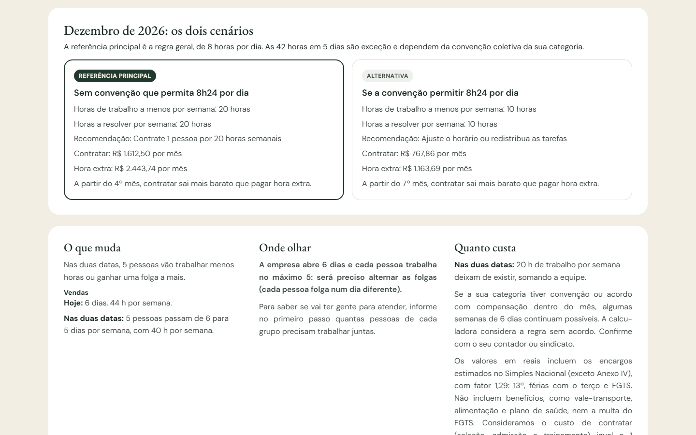

# Calculadora da escala 6x1

**Sua escala cabe na regra nova?** Uma calculadora para pequenas e médias empresas descobrirem o que muda com o fim da escala 6x1: quem é afetado, quantas horas de trabalho deixam de existir e quanto custa cada caminho para se adaptar.

**Versão no ar:** [capitalhumanointelligence.com/escala-6x1](https://capitalhumanointelligence.com/escala-6x1)

Criada por Daniela Matos ([LinkedIn](https://www.linkedin.com/in/danielamatosfreitas)) para a Capital Humano Intelligence, consultoria de gestão de pessoas.

[English version below](#english)

| Computador | Celular |
|---|---|
|  |  |
|  |  |

## O problema

A emenda constitucional que acaba com a escala 6x1 foi publicada em 16/10/2026. A jornada máxima cai em duas etapas e cada pessoa passa a ter dois dias de descanso por semana. Para o dono de uma loja, de um mercado ou de uma clínica, as perguntas são práticas: minha equipe vai trabalhar menos? Vou ter gente para atender nos dias de folga? Preciso contratar? Sai mais barato contratar ou pagar hora extra?

Essas respostas dependem de contas que pouca gente faz sozinha, e a regra de dezembro de 2026 muda conforme a convenção coletiva de cada categoria.

## A solução

Uma página em 3 passos, em linguagem simples:

1. **Equipe:** grupos de pessoas que trabalham nos mesmos dias e com as mesmas horas (quantas pessoas, dias, horas por semana, salário médio opcional).
2. **Atendimento:** horário em que a empresa abre e fecha, e se a convenção da categoria permite 8h24 por dia (Sim, Não ou Não sei).
3. **Resultado:** respostas rápidas, os números de cada etapa (dezembro de 2026 e dezembro de 2027), três caminhos lado a lado (ajustar o horário, contratar ou pagar hora extra), o mês em que contratar passa a sair mais barato e um PDF gerado pelo próprio navegador.

Uma prévia ao vivo mostra o efeito enquanto a pessoa preenche. Quando a resposta da convenção é "Não sei", o resultado mostra os dois cenários lado a lado.

## A regra usada

* **Hoje:** até 44 horas por semana, com 1 folga.
* **A partir de dezembro de 2026:** escala 5x2, até 8 horas por dia, ou seja, 40 horas em 5 dias. Até 42 horas semanais em 5 dias (cerca de 8h24 por dia) **só com convenção ou acordo coletivo** que permita.
* **A partir de dezembro de 2027:** até 40 horas por semana para todos.
* Sem redução de salário.

### Como o cálculo funciona

* Dias novos = mínimo(dias de hoje, 5).
* Horas novas em dezembro de 2026 = mínimo(horas, 42, dias novos × 8 + 2) com convenção; mínimo(horas, 42, dias novos × 8) sem convenção.
* Horas novas em dezembro de 2027 = mínimo(horas, 40, dias novos × 8).
* Horas a menos = (horas de hoje − horas novas) × pessoas do grupo.
* Cobertura (opcional): quando a pessoa informa quantas precisam trabalhar juntas, a conta compara as horas e os dias de presença necessários com o que a equipe consegue fazer depois da mudança. Se faltam dias de trabalho, hora extra não resolve.
* Contratação em pessoas inteiras: tempo parcial até 30 horas; acima disso, tempo integral; sobra de 12 a 30 horas vira meio período; abaixo de 12 horas, o indicado é ajustar o horário.
* Encargos: fator 1,29 no Simples Nacional (13º, férias com o terço e FGTS) e 1,62 fora dele; "Não sei" mostra a faixa.
* Hora extra: valor da hora × 1,5 × 7/6 (descanso semanal remunerado) × fator de encargos.

## Tecnologias

* HTML, CSS e JavaScript puro, sem framework e sem etapa de build.
* O cálculo é uma função pura (`calcular`, `etapa` e `custos` em `js/escala-6x1.js`), separada da tela e usada também pela prévia ao vivo.
* Testes com o executor de testes nativo do Node.js (`node --test`), sem dependências.
* Acessibilidade: contraste WCAG AA, rótulos em todos os campos, navegação por teclado nas abas, respeito a "reduzir movimento".
* Layout responsivo do celular (360 px) a telas grandes, e PDF pela impressão do navegador.
* Fontes EB Garamond e DM Sans servidas pelo próprio projeto.

## Como rodar

Abra o `index.html` no navegador. Para servir por HTTP (recomendado, por causa das fontes):

```bash
npx serve .
```

## Testes

Precisa do Node.js 18 ou mais novo.

```bash
npm test
```

Os testes cobrem a loja do caso conferido (5 vendedoras, 44 horas, R$ 2.500, Simples Nacional) nos três cenários da convenção:

| Convenção permite 8h24 | Dez. 2026 | Dez. 2027 | Contratar em dez. 2026 |
|---|---|---|---|
| Sim | 10 horas a menos (ajustar o horário) | 20 horas a menos | R$ 767,86 por mês |
| Não | 20 horas a menos | 20 horas a menos | R$ 1.612,50 por mês |
| Não sei | os dois cenários lado a lado | 20 horas a menos | R$ 1.612,50 (principal) |

E também: regime tributário, equipe que não muda, mudança só pela folga, cobertura do horário, falta de dias (hora extra não resolve), dados impossíveis e contratação em pessoas inteiras.

## Aviso

O resultado é uma **estimativa**. Não substitui a orientação do contador nem a convenção coletiva da categoria. As regras de transição ainda podem ser detalhadas, e escalas de revezamento, como a 12x36, seguem regras próprias.

Nesta versão de portfólio, nada é gravado nem enviado: não há medição de visitas nem formulário de contato. O PDF é gerado pelo navegador (Imprimir, Salvar como PDF).

## Direitos de uso

Este repositório **não tem licença aberta**. O código está visível para consulta e avaliação do trabalho. Copiar, modificar, publicar ou usar o código, no todo ou em parte, exige autorização por escrito de Daniela Matos.

© 2026 Daniela Matos, Capital Humano Intelligence. Todos os direitos reservados.

Componentes de terceiros, com as licenças deles: fontes EB Garamond e DM Sans (SIL Open Font License 1.1, em `fonts/OFL.txt`) e ícones do Font Awesome Free 6.4.0 (CC BY 4.0).

<a id="english"></a>

# 6x1 work schedule calculator (English)

**Does your schedule fit the new rule?** A calculator that helps small and medium businesses in Brazil understand the end of the "6x1" schedule (six working days, one day off): who is affected, how many working hours disappear and how much each way of adapting costs.

**Live version (Portuguese):** [capitalhumanointelligence.com/escala-6x1](https://capitalhumanointelligence.com/escala-6x1)

Built by Daniela Matos ([LinkedIn](https://www.linkedin.com/in/danielamatosfreitas)) for Capital Humano Intelligence, a people management consultancy.

## The problem

The constitutional amendment that ends the 6x1 schedule was published on October 16, 2026. The maximum working week drops in two stages and every employee gets two days off per week. Store, market and clinic owners need practical answers: will my team work fewer hours? Will I have enough people on the days off? Do I need to hire? Is hiring cheaper than paying overtime?

These answers depend on calculations few business owners do on their own, and the December 2026 rule depends on each category's collective agreement.

## The solution

A 3 step page in plain language:

1. **Team:** groups of people who work the same days and hours (headcount, days, weekly hours, optional average salary).
2. **Opening hours:** when the business opens and closes, and whether the collective agreement allows 8h24 per day (Yes, No or I don't know).
3. **Result:** quick answers, the numbers for each stage (December 2026 and December 2027), three options side by side (adjust opening hours, hire or pay overtime), the month when hiring becomes cheaper, and a PDF generated by the browser.

A live preview shows the effect while the form is being filled. When the collective agreement answer is "I don't know", the result shows both scenarios side by side.

## The rule

* **Today:** up to 44 hours per week, 1 day off.
* **From December 2026:** 5x2 schedule, up to 8 hours per day, that is, 40 hours in 5 days. Up to 42 weekly hours in 5 days (about 8h24 per day) **only with a collective agreement** that allows it.
* **From December 2027:** up to 40 hours per week for everyone.
* No salary reduction.

The formulas are listed in the Portuguese section above ("Como o cálculo funciona").

## Tech stack

* Plain HTML, CSS and JavaScript, no framework and no build step.
* The calculation is a pure function (`calcular`, `etapa` and `custos` in `js/escala-6x1.js`), separate from the UI and also used by the live preview.
* Tests with the built in Node.js test runner (`node --test`), no dependencies.
* Accessibility: WCAG AA contrast, labels on every field, keyboard navigation on tabs, reduced motion support.
* Responsive layout from 360 px phones to large screens, and PDF through the browser's print dialog.
* EB Garamond and DM Sans fonts served by the project itself.

## Running

Open `index.html` in a browser, or serve it over HTTP:

```bash
npx serve .
```

## Tests

Requires Node.js 18 or newer.

```bash
npm test
```

The tests cover the reference case (a store with 5 salespeople, 44 hours per week, R$ 2,500 salary, Simples Nacional tax regime) in the three collective agreement scenarios (Yes: 10 and 20 fewer hours; No: 20 and 20 fewer hours, hiring at R$ 1,612.50 per month; I don't know: both scenarios), plus tax regime, teams that don't change, staffing coverage, missing working days (overtime doesn't solve it), impossible data and hiring in whole people.

## Disclaimer

The result is an **estimate**. It does not replace advice from an accountant or the category's collective agreement. Transition rules may still be detailed, and rotating schedules such as 12x36 follow their own rules.

This portfolio version stores and sends nothing: there is no analytics and no contact form. The PDF is generated by the browser (Print, Save as PDF).

## Usage rights

This repository has **no open source license**. The code is visible for reference and evaluation of the work. Copying, modifying, publishing or using the code, in whole or in part, requires written permission from Daniela Matos.

© 2026 Daniela Matos, Capital Humano Intelligence. All rights reserved.

Third party components keep their own licenses: EB Garamond and DM Sans fonts (SIL Open Font License 1.1, in `fonts/OFL.txt`) and Font Awesome Free 6.4.0 icons (CC BY 4.0).
